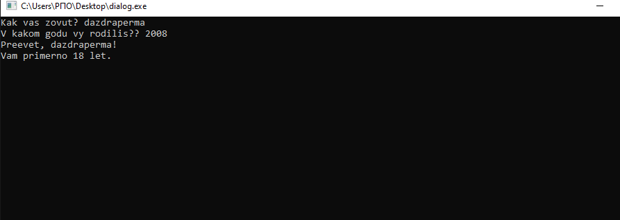
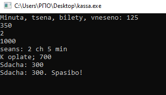

## Разминка

1. Комментарий `//` — однострочный (удобен для кратких пояснений в конце строки), а `/* ... */` — многострочный (удобен для больших блоков текста или временного отключения фрагментов кода).
2. `5+3=8`
3. Оба символа переводят курсор на новую строку, но `std::endl` дополнительно принудительно сбрасывает буфер вывода (`flush`), а `\n` — нет.
4. Синтаксические ошибки (проявляются на этапе компиляции/сборки), ошибки времени выполнения — Runtime Errors (проявляются после запуска программы), логические ошибки (программа собирается и запускается, но выдаёт неверный результат).
5. `7 / 2` равно `3`; `7 % 2` равно `1`; `125 % 60` равно `5`.
6. `7 / 2` даёт целое число `3` (целочисленное деление отбрасывает дробную часть), а `7.0 / 2` даёт `3.5`, так как наличие числа с плавающей точкой (`7.0`) переводит операцию в вещественное деление.

### Задание 3 (`dialog.cpp` после добавления третьего вопроса)

  

### Контрольная точка К2 (`kassa.cpp`)

  

